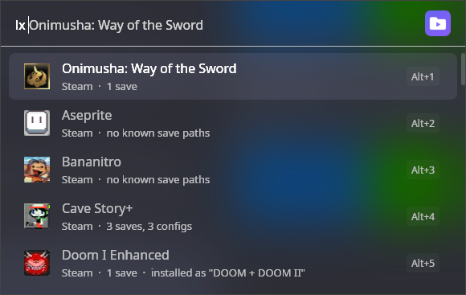
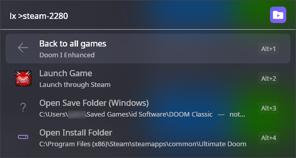
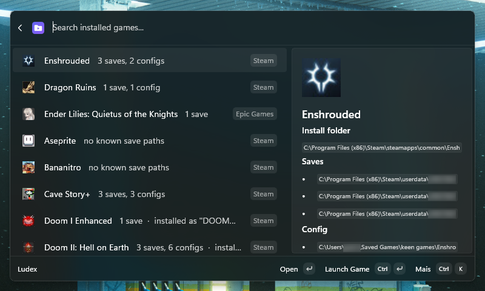
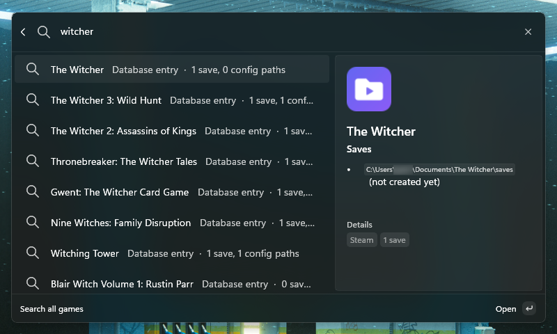
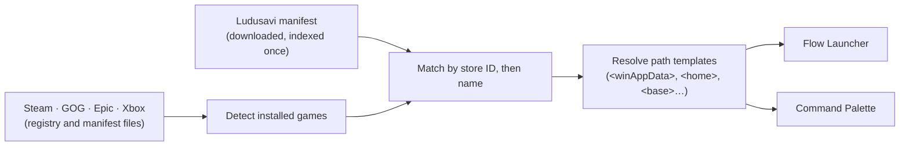

<div align="center">

<picture>
  <source media="(prefers-color-scheme: dark)" srcset="assets/branding/banner-dark.png">
  
</picture>

<br>

[](LICENSE)
[](https://dotnet.microsoft.com)
[](#install)
[](src/FlowLauncher/README.md)
[](src/CommandPalette/README.md)
[](raycast/README.md)
[](https://github.com/Leocadio94/ludex/stargazers)

**[Features](#features) · [Versions](#versions) · [Install](#install) · [How it works](#how-it-works) · [Credits](#credits)**

**English** · [Português (Brasil)](README.pt-BR.md)

</div>

---

Every PC game hides its saves somewhere different: `AppData\Roaming`, `AppData\LocalLow`,
`Documents\My Games`, the Steam Cloud folder, or right next to the executable. Ludex puts them one keystroke
away. Open your launcher, type a game, and jump to its save folder, its config, its install directory, or just
start the game.

<p align="center">
  
  
</p>
<p align="center">
  
  
</p>

## Features

- **Finds your games** in Steam, GOG, Epic Games and Xbox / Game Pass, straight from each store's own files.
  No PowerShell, and no launcher has to be running.
- **Opens the right folder**: saves, config and install directory, for essentially every PC game, using the
  community-maintained [Ludusavi manifest](https://github.com/mtkennerly/ludusavi-manifest).
- **Launches the game** through the store it came from (Steam and Epic by protocol, Xbox through the shell,
  GOG by running the executable directly, so Galaxy doesn't need to be open).
- **Searches the whole database**, including games you haven't installed.
- **Behaves sensibly**: several save files in one folder collapse into one row; a save folder that doesn't exist
  yet opens the nearest parent that does; games the database doesn't know still show their install folder.
- **Looks right**: each game shows its own store artwork.
- **Fast**: the database is indexed once and the installed-games list is cached, so typing doesn't re-scan the stores.

## Versions

| Launcher | Language | Status | Docs |
|---|---|---|---|
| [Flow Launcher](https://www.flowlauncher.com) | C# | Works; install from source | [src/FlowLauncher](src/FlowLauncher/README.md) |
| [PowerToys Command Palette](https://learn.microsoft.com/windows/powertoys/command-palette/overview) | C# | Works; install from source | [src/CommandPalette](src/CommandPalette/README.md) |
| [Raycast](https://raycast.com) | TypeScript | Works; install from source | [raycast](raycast/README.md) |

The Flow Launcher and Command Palette versions are thin front ends over the same C# library,
[`Ludex.Core`](src/Core): store detection, manifest download and indexing, matching and path resolution. The
Raycast version is a separate TypeScript implementation of the same idea and shares no code with them, so its
behaviour differs in places. [Why the repository is shaped this way](docs/decisions/0001-monorepo-with-shared-core.md).

None of them is in a store yet.

## Install

Windows only, built from source. Flow Launcher needs the [.NET 9 SDK](https://dotnet.microsoft.com/download/dotnet/9.0);
the Command Palette extension needs Visual Studio (see below); Raycast needs Node.js.

**Flow Launcher**

```powershell
git clone https://github.com/Leocadio94/ludex
cd ludex
.\scripts\deploy.ps1      # builds, installs into Flow and restarts it
```

Then type `lx` in Flow.

**Command Palette**: open `Ludex.sln` in Visual Studio, pick *Debug* and *x64*, then *Build > Deploy Ludex* and run
`Reload` in Command Palette. Full steps and the one-time alias for `lx`:
[docs/command-palette.md](docs/command-palette.md).

**Raycast**

```bash
cd raycast
npm install
npm run dev
```

## Usage

| | Flow Launcher | Command Palette | Raycast |
|---|---|---|---|
| Your games | `lx` | **Ludex** | **Browse Games** |
| Filter | `lx witcher` | type in the list | type in the list |
| Search everything | `lx !all doom` | **Ludex: Search all games** | **Search Games** |
| Re-scan the stores | `lx !games` | **Ludex: Refresh installed games** | **Refresh Installed Games** |
| Re-download the database | `lx !refresh` | **Ludex: Refresh game database** | **Refresh Game Database** |

Pick a game to see **Launch Game** and one row per save, config and install folder.

## Language

Ludex is available in two languages for now: **English** and **Brazilian Portuguese**.

| Launcher | English | Português (Brasil) | Chosen by |
|---|---|---|---|
| Flow Launcher | yes | yes | Flow's own language setting, applied live |
| Command Palette | yes | yes | the Windows display language, read when the extension starts (run `Reload` after changing it) |
| Raycast | yes | no | English only: Raycast does not support localisation in extensions |

Any other language falls back to English. There is a Portuguese version of this page:
[README.pt-BR.md](README.pt-BR.md).

## How it works



The manifest is parsed line by line and written to a compact on-disk index, so the whole file is never held in
memory. More in [docs/architecture.md](docs/architecture.md).

## Repository layout

```
src/Core            Ludex.Core: detection, manifest, matcher, path resolver
src/FlowLauncher    Flow Launcher plugin
src/CommandPalette  PowerToys Command Palette extension
raycast             Raycast extension (TypeScript, independent)
scripts             deploy and icon generation for the Flow plugin
docs                architecture, decisions, how-tos
assets/branding     logo and README banners
```

## Credits

Ludex knows nothing about games on its own. Everything it shows comes from the
[**Ludusavi manifest**](https://github.com/mtkennerly/ludusavi-manifest) by
[Matthew T. Kennerly](https://github.com/mtkennerly), an open-source, community-maintained database of save and
config locations, distributed under the MIT licence. The manifest is in turn compiled from
[**PCGamingWiki**](https://www.pcgamingwiki.com), whose contributors document where each game keeps its saves
(content licensed [CC BY-NC-SA 3.0](https://creativecommons.org/licenses/by-nc-sa/3.0/)).

**If a game's paths are wrong or missing, fix them at the source.** Edit the article on PCGamingWiki and the
correction flows into the manifest, and from there into Ludex on the next refresh. Opening an issue here cannot
fix the data.

Built for [Flow Launcher](https://www.flowlauncher.com), [PowerToys](https://github.com/microsoft/PowerToys) and
[Raycast](https://raycast.com). Ludex is not affiliated with any of them. Full list of dependencies:
[THIRD_PARTY_NOTICES.md](THIRD_PARTY_NOTICES.md).

## Licence

[MIT](LICENSE) © 2026 Gabriel Leocádio. The game database is not redistributed with Ludex; it is downloaded from
the Ludusavi manifest repository at runtime and cached locally.
