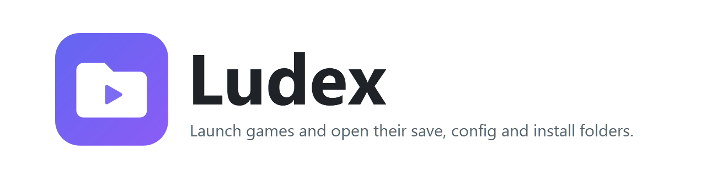
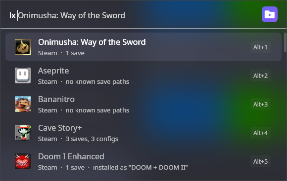
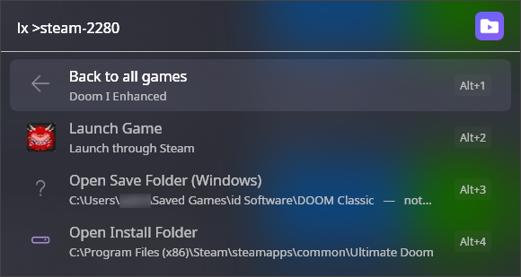
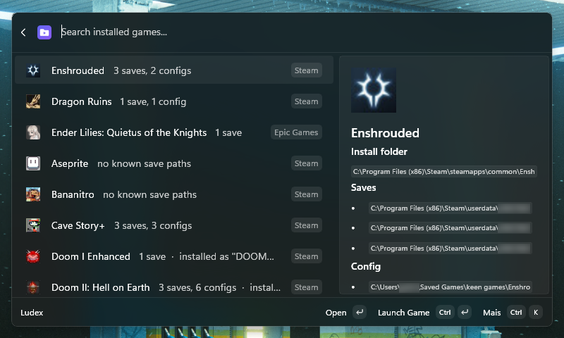
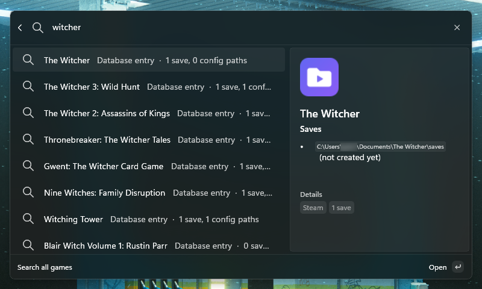
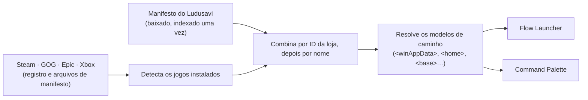

<div align="center">

<picture>
  <source media="(prefers-color-scheme: dark)" srcset="assets/branding/banner-dark.png">
  
</picture>

<br>

[](LICENSE)
[](https://dotnet.microsoft.com)
[](#instalação)
[](src/FlowLauncher/README.md)
[](src/CommandPalette/README.md)
[](raycast/README.md)
[](https://github.com/Leocadio94/ludex/stargazers)

**[Funcionalidades](#funcionalidades) · [Versões](#versões) · [Instalação](#instalação) · [Como funciona](#como-funciona) · [Créditos](#créditos)**

[English](README.md) · **Português (Brasil)**

</div>

---

Cada jogo de PC guarda os saves num lugar diferente: `AppData\Roaming`, `AppData\LocalLow`,
`Documents\My Games`, a pasta do Steam Cloud, ou ao lado do executável. O Ludex deixa tudo a uma tecla de
distância. Abra o seu launcher, digite o nome de um jogo e vá direto para a pasta de save, a de configuração, a
pasta de instalação, ou simplesmente inicie o jogo.

<p align="center">
  
  
</p>
<p align="center">
  
  
</p>

> As capturas de tela estão em inglês, que é o idioma padrão. Veja [Idioma](#idioma) para saber onde o Ludex
> aparece em português.

## Funcionalidades

- **Encontra os seus jogos** na Steam, GOG, Epic Games e Xbox / Game Pass, direto dos arquivos de cada loja.
  Sem PowerShell, e sem precisar que algum launcher esteja aberto.
- **Abre a pasta certa**: saves, configurações e pasta de instalação, para praticamente todo jogo de PC, usando o
  [manifesto do Ludusavi](https://github.com/mtkennerly/ludusavi-manifest), mantido pela comunidade.
- **Inicia o jogo** pela loja de onde ele veio (Steam e Epic por protocolo, Xbox pelo shell, GOG executando o
  arquivo direto, então a Galaxy não precisa estar aberta).
- **Pesquisa em todo o banco de dados**, inclusive jogos que você não instalou.
- **Se comporta com bom senso**: vários arquivos de save na mesma pasta viram uma linha só; se a pasta de save
  ainda não existe, abre a pasta-pai mais próxima que exista; jogos que o banco não conhece ainda mostram a pasta
  de instalação.
- **Fica bonito**: cada jogo aparece com a arte da própria loja.
- **É rápido**: o banco é indexado uma vez e a lista de jogos instalados fica em cache, então digitar não
  refaz a varredura das lojas.

## Versões

| Launcher | Linguagem | Situação | Documentação |
|---|---|---|---|
| [Flow Launcher](https://www.flowlauncher.com) | C# | Funciona; instalação a partir do código-fonte | [src/FlowLauncher](src/FlowLauncher/README.md) |
| [PowerToys Command Palette](https://learn.microsoft.com/windows/powertoys/command-palette/overview) | C# | Funciona; instalação a partir do código-fonte | [src/CommandPalette](src/CommandPalette/README.md) |
| [Raycast](https://raycast.com) | TypeScript | Funciona; instalação a partir do código-fonte | [raycast](raycast/README.md) |

As versões do Flow Launcher e do Command Palette são interfaces finas sobre a mesma biblioteca C#,
[`Ludex.Core`](src/Core): detecção das lojas, download e indexação do manifesto, correspondência e resolução de
caminhos. A versão do Raycast é uma implementação separada em TypeScript da mesma ideia e não compartilha código
com as outras, então o comportamento difere em alguns pontos.
[Por que o repositório tem esse formato](docs/decisions/0001-monorepo-with-shared-core.md) (em inglês).

Nenhuma delas está em uma loja ainda.

## Instalação

Só Windows, compilando a partir do código-fonte. O Flow Launcher precisa do
[.NET 9 SDK](https://dotnet.microsoft.com/download/dotnet/9.0); a extensão do Command Palette precisa do Visual
Studio (veja abaixo); o Raycast precisa do Node.js.

**Flow Launcher**

```powershell
git clone https://github.com/Leocadio94/ludex
cd ludex
.\scripts\deploy.ps1      # compila, instala no Flow e reinicia o Flow
```

Depois, digite `lx` no Flow.

**Command Palette**: abra `Ludex.sln` no Visual Studio, escolha *Debug* e *x64*, depois *Build > Deploy Ludex* e
rode `Reload` no Command Palette. Passo a passo completo e o alias único para `lx`:
[docs/command-palette.md](docs/command-palette.md) (em inglês).

**Raycast**

```bash
cd raycast
npm install
npm run dev
```

## Uso

| | Flow Launcher | Command Palette | Raycast |
|---|---|---|---|
| Seus jogos | `lx` | **Ludex** | **Browse Games** |
| Filtrar | `lx witcher` | digite na lista | digite na lista |
| Pesquisar tudo | `lx !all doom` | **Ludex: Search all games** | **Search Games** |
| Reescanear as lojas | `lx !games` | **Ludex: Refresh installed games** | **Refresh Installed Games** |
| Baixar o banco de novo | `lx !refresh` | **Ludex: Refresh game database** | **Refresh Game Database** |

Escolha um jogo para ver **Launch Game** e uma linha para cada pasta de save, configuração e instalação. Os nomes
dos comandos aparecem em inglês, exceto onde o [Idioma](#idioma) diz o contrário.

## Idioma

O inglês é o idioma padrão em todas as versões.

| Launcher | Português (Brasil) |
|---|---|
| Flow Launcher | Disponível: os textos seguem o idioma escolhido no Flow (Settings > General > Language) |
| Command Palette | Disponível: segue o idioma de exibição do Windows (rode `Reload` depois de trocar) |
| Raycast | Não é possível: o Raycast só suporta inglês dos EUA em extensões |

## Como funciona



O manifesto é lido linha a linha e gravado em um índice compacto em disco, então o arquivo inteiro nunca fica na
memória. Mais detalhes em [docs/architecture.md](docs/architecture.md) (em inglês).

## Estrutura do repositório

```
src/Core            Ludex.Core: detecção, manifesto, correspondência, resolução de caminhos
src/FlowLauncher    plugin do Flow Launcher
src/CommandPalette  extensão do PowerToys Command Palette
raycast             extensão do Raycast (TypeScript, independente)
scripts             deploy e geração de ícones do plugin do Flow
docs                arquitetura, decisões, guias
assets/branding     logo e banners do README
```

## Créditos

O Ludex não sabe nada sobre jogos por conta própria. Tudo o que ele mostra vem do
[**manifesto do Ludusavi**](https://github.com/mtkennerly/ludusavi-manifest), de
[Matthew T. Kennerly](https://github.com/mtkennerly), um banco de dados aberto, mantido pela comunidade, com a
localização de saves e configurações, distribuído sob a licença MIT. O manifesto, por sua vez, é compilado a partir
da [**PCGamingWiki**](https://www.pcgamingwiki.com), cujos colaboradores documentam onde cada jogo guarda os saves
(conteúdo sob licença [CC BY-NC-SA 3.0](https://creativecommons.org/licenses/by-nc-sa/3.0/)).

**Se os caminhos de um jogo estiverem errados ou faltando, corrija na origem.** Edite o artigo na PCGamingWiki e a
correção chega ao manifesto e, de lá, ao Ludex no próximo refresh. Abrir uma issue aqui não conserta os dados.

Feito para o [Flow Launcher](https://www.flowlauncher.com), o [PowerToys](https://github.com/microsoft/PowerToys) e
o [Raycast](https://raycast.com). O Ludex não é afiliado a nenhum deles. Lista completa de dependências:
[THIRD_PARTY_NOTICES.md](THIRD_PARTY_NOTICES.md).

## Licença

[MIT](LICENSE) © 2026 Gabriel Leocádio. O banco de jogos não é redistribuído com o Ludex: ele é baixado do
repositório do manifesto do Ludusavi durante a execução e fica em cache local.
