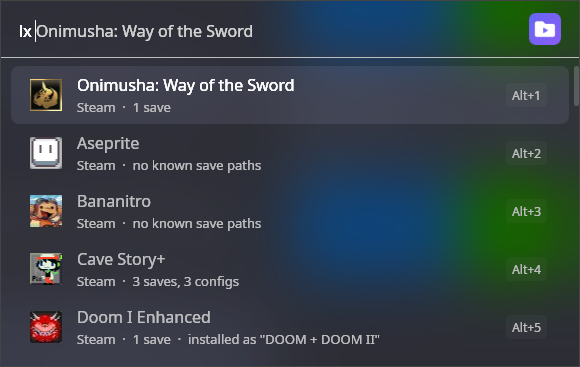
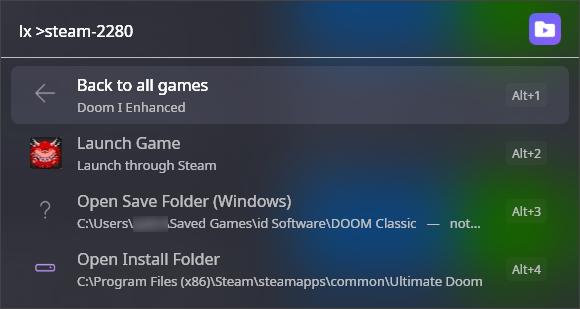

<div align="center">

<picture>
  <source media="(prefers-color-scheme: dark)" srcset="../../assets/branding/banner-dark.png">
  
</picture>

<br>

[](../../LICENSE)
[](https://dotnet.microsoft.com)
[](#installation)
[](https://www.flowlauncher.com)
[](https://github.com/Leocadio94/ludex/releases)

**[Usage](#usage) · [Settings](#settings) · [Installation](#installation) · [How it works](#how-it-works) · [Credits](#credits)**

</div>

---

Every PC game hides its saves somewhere different: `AppData\Roaming`, `AppData\LocalLow`,
`Documents\My Games`, the Steam Cloud folder, or right next to the executable. This plugin lists the
games installed on your machine, opens the right folder for each one and can launch them, all from
Flow Launcher.

Save locations come from the [Ludusavi manifest](https://github.com/mtkennerly/ludusavi-manifest), a
community-maintained database covering essentially every PC game. It holds the same data as
PCGamingWiki, in a form software can read. Stores detected: Steam, GOG, Epic Games and Xbox / Game Pass.

<p align="center">
  
  
</p>

## Usage

| Query | What it does |
|---|---|
| `lx` | List every installed game |
| `lx witcher` | Filter the installed games by name |
| `lx !games` | Re-scan the stores for newly installed games |
| `lx !refresh` | Re-download and re-index the game database |
| `lx !all doom` | Search the whole database, including games you have not installed |

Press <kbd>Enter</kbd> on a game to see its actions, then <kbd>Enter</kbd> again to run one. On a folder,
<kbd>Ctrl</kbd>+<kbd>O</kbd> opens the context menu, where you can copy the path instead of opening it.

The actions:

- Launch Game starts the game through the store it came from. Steam and the Epic launcher are started by
  protocol and the Xbox app through the shell. GOG titles run their executable directly, so they start
  whether or not GOG Galaxy is open.
- Open Save Folder and Open Config Folder open the folder where the game keeps its data. Several save files
  in the same folder collapse into one entry, so you never see the same destination twice.
- Open Install Folder opens the game's own directory, even for games missing from the database.

A few details worth knowing:

- Each game shows its own store artwork instead of a generic icon.
- A save folder that does not exist yet, which is normal for a game you have never launched, says so.
  Opening it takes you to the nearest folder that does exist.
- Refreshing shows a progress bar while the database downloads and indexes.
- Games in your library that the database does not know are still listed with their install folder. You
  can turn this off in the settings.

## Settings

Flow Launcher, Settings, Plugins, Ludex.

| Setting | Default | What it does |
|---|---|---|
| Stores to scan | all on | Turns Steam, GOG, Epic or Xbox detection on or off. |
| Default order for `lx` | Most used first | Most used first lets Flow float the games you open often to the top. Alphabetical (A-Z) gives a fixed order that ignores usage. It only affects the plain `lx` list, because searching always ranks by relevance. |
| Show games with no manifest entry | on | Lists installed games the database does not know, with just their install folder. Off hides them. |
| Maximum results | 50 | How many games the list shows at once. |
| Game database refresh interval (days) | 7 | How often the Ludusavi manifest is downloaded again. `lx !refresh` does it immediately. |
| Installed games cache lifetime (minutes) | 60 | How long the detected games list is reused before the stores are scanned again. `lx !games` forces a scan. |

## Installation

Requires Flow Launcher 2.0 or newer on Windows 10 or 11. The plugin is not in the Flow plugin store yet.
Until it is, install it from the latest release by typing this in Flow:

```
pm install https://github.com/Leocadio94/ludex/releases/download/v1.0.0/Flow.Launcher.Plugin.Ludex-1.0.0.zip
```

To build it yourself, you need the .NET 9 SDK:

```powershell
git clone https://github.com/Leocadio94/ludex
cd ludex
.\scripts\deploy.ps1
```

The script builds the plugin, installs it into `%APPDATA%\FlowLauncher\Plugins` and restarts Flow Launcher.

The first query downloads and indexes the database (about 17 MB, a few seconds). After that everything is
served from memory, and the database refreshes itself on the interval above.

## How it works

1. Detect. Read each store's own metadata: Steam `.acf` files, the GOG and Xbox registries and Epic's JSON
   manifests. No PowerShell, and no store client has to be running.
2. Index. Download the Ludusavi manifest and parse it into a compact on-disk index, filtered to Windows.
3. Match. Join detected games to the manifest by store ID, then by name.
4. Resolve. Turn manifest path templates (`<winAppData>`, `<home>`, `<base>` and so on) into real folders on
   your machine, expanding wildcards against the filesystem.

The whole pipeline runs once per Flow session, then serves from memory.

## Language

English by default, and Brazilian Portuguese when Flow's language is set to it (Settings, General,
Language). How it works and how to add text: [docs/localization.md](../../docs/localization.md).

## Related

Ludex also ships for [Raycast](../../raycast/README.md) and the PowerToys
[Command Palette](../CommandPalette/README.md). The detection and path resolution in this plugin live in
[`src/Core`](../Core) and are shared with the Command Palette version. The Raycast version is an independent
TypeScript implementation. See the [repository README](../../README.md).

## Credits

This plugin knows nothing about games on its own. Everything it shows comes from the
[Ludusavi manifest](https://github.com/mtkennerly/ludusavi-manifest) by
[Matthew T. Kennerly](https://github.com/mtkennerly), an open-source, community-maintained database of save
and config locations, distributed under the MIT licence. The manifest is compiled from
[PCGamingWiki](https://www.pcgamingwiki.com), whose contributors document where each game keeps its saves
(content licensed [CC BY-NC-SA 3.0](https://creativecommons.org/licenses/by-nc-sa/3.0/)).

If a game's paths are wrong or missing, fix them at the source. Edit the article on PCGamingWiki and the
correction reaches the manifest, and from there this plugin and every other tool built on it, on the next
refresh. Opening an issue here cannot fix the data.

Built for [Flow Launcher](https://www.flowlauncher.com), which is itself open source. Ludex is not affiliated
with it.

## Licence

[MIT](../../LICENSE), © 2026 Gabriel Leocádio. The game database is not redistributed with this plugin. It is
downloaded from the Ludusavi manifest repository at runtime and cached locally.
